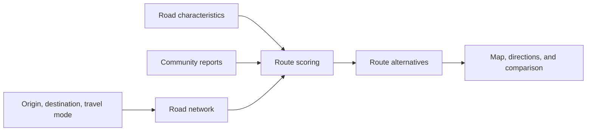

# SafeRoute

**Compare routes with more context about the roads ahead.**

SafeRoute is a map-based route-planning application that combines OpenStreetMap road data with community-reported issues. It compares faster and safety-weighted alternatives for walking, cycling, and driving, bringing route details and local reports into one interface.

## Explore the app

- **Compare routes** using distance, estimated travel time, and a computed safety score.
- **Choose how you travel:** walking, cycling, or driving.
- **Search for places** with location suggestions and map-based selection.
- **View directions** and follow the route on an interactive map.
- **Report road issues** and help validate reports from other users.
- **Explore local conditions** through issue markers, clustering, and a heatmap.
- **Track your contributions** through an account and reporting statistics.

## How a route is built



The routing engine combines road attributes with issue location, category, confidence, and recency. A route's safety score is a comparative estimate based on these inputs.

## Built with

| Layer | Technologies |
| --- | --- |
| Interface | HTML, CSS, JavaScript, Leaflet |
| API | Python, FastAPI |
| Routing | OSMnx, NetworkX, Shapely, SciPy |
| Data | SQLAlchemy, PostgreSQL, Alembic |
| Accounts | JWT authentication and password hashing |
| Map services | OpenStreetMap, Geoapify, optional Ola Maps and OpenRouteService integrations |

<details>
<summary><strong>Run locally</strong></summary>

### 1. Set up Python

```bash
git clone https://github.com/DebapriyaK/Safety_route_recommendation.git
cd Safety_route_recommendation
python -m venv .venv
```

Activate the environment with `.venv\Scripts\Activate.ps1` on Windows PowerShell or `source .venv/bin/activate` on macOS/Linux, then install the dependencies:

```bash
python -m pip install -r backend/requirements.txt
```

### 2. Configure a local demo

Copy `backend/.env.example` to `backend/.env`. For a local SQLite demo, set:

```dotenv
DATABASE_URL=sqlite:///./saferoute.db
AUTO_CREATE_TABLES=1
ROUTING_PRELOAD_ENABLED=0
EMAIL_ENABLED=0
SECRET_KEY=replace-with-a-random-secret
GEOAPIFY_KEY=your-geoapify-api-key
```

Generate a value for `SECRET_KEY` with:

```bash
python -c "import secrets; print(secrets.token_hex(32))"
```

The default map center is Bengaluru. Change `DEFAULT_CITY_LAT` and `DEFAULT_CITY_LON` to explore another area. Routing downloads road data as needed; place search uses the configured geocoding service.

### 3. Start the application

```bash
python -m uvicorn backend.main:app --reload --port 8000
```

Open [localhost:8000](http://localhost:8000). Interactive API documentation is available at [localhost:8000/docs](http://localhost:8000/docs).

</details>

## Explore the code

| Component | Purpose |
| --- | --- |
| [`backend/routing.py`](backend/routing.py) | Road graphs, route scoring, and directions |
| [`backend/issues.py`](backend/issues.py) | Community reporting and validation |
| [`backend/auth.py`](backend/auth.py) | Accounts and authentication |
| [`backend/models.py`](backend/models.py) | Data models |
| [`backend/main.py`](backend/main.py) | API and application startup |
| [`frontend/`](frontend/) | Map interface and account pages |
